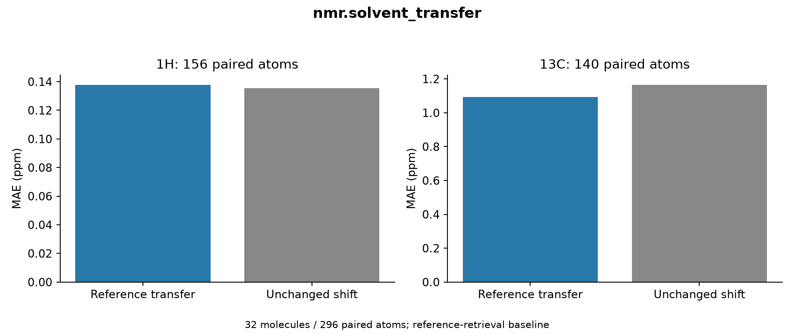

# Cross-solvent chemical shift transfer

[Expanded NMR evaluations](../benchmarks/nmr.md) include all held-out experimental sites, all eligible cross-solvent pairs, and 2,048-candidate retrieval.

Estimate a spectrum in a target solvent from measurements in a source solvent.

## Expanded paired reference benchmark

All eligible reviewed pairs gave 46 distinct molecular connectivities and 442 atom-shift pairs. With the query connectivity excluded from the reference search, ¹H MAE was 0.151 ppm versus 0.159 ppm for retaining the source shift (159 atoms). For ¹³C the corresponding values were 1.144 and 1.238 ppm (283 atoms). Seven pairs lacked an independent reference for their solvent combination.

## What goes in

| Field | Meaning |
| --- | --- |
| `structure / nucleus` | Molecular connectivity and 1H or 13C. |
| `solvents` | Explicit source and target solvents that have paired references. |
| `source_ppm` | Measured source-solvent shifts in ppm. |

## What comes out

| Field | Meaning |
| --- | --- |
| `target_ppm / delta_ppm` | Estimated target shift and solvent difference from an independent reference. |
| `reference` | Reference identity, spectra/atom IDs, Tanimoto similarity and exclusions. |

## A real recorded example

Inspect the input, prediction and reference for the example below. Download the JSON for the complete numerical arrays and additional examples.



[SVG](../assets/gallery/nmr-solvent_transfer.svg) · [PNG](../assets/gallery/nmr-solvent_transfer.png) · [Full input/output JSON](../assets/examples/nmr-solvent_transfer.json)

<details><summary>Inspect the actual input and output fields</summary>

```json
{
  "input": {
    "nucleus": "1H",
    "source_ppm": 1.45,
    "source_solvent": "CD3OD",
    "target_solvent": "acetone-d6",
    "query_connectivity": "C1CCCCC1"
  },
  "output": {
    "source_ppm": 1.45,
    "predicted_target_ppm": 1.3799999999999997,
    "predicted_delta_ppm": -0.07000000000000028,
    "source_solvent": "CD3OD",
    "target_solvent": "acetone-d6",
    "nucleus": "1H",
    "query_connectivity": "C1CCCCC1",
    "reference": {
      "identity": "C1COCCO1",
      "molecule_id": "10016061",
      "atom_id": "10093018",
      "source_ppm": 3.66,
      "target_ppm": 3.59,
      "source_spectrum_ids": [
        "20197666"
      ],
      "target_spectrum_ids": [
        "20197080"
      ]
    },
    "tanimoto_similarity": 0.125,
    "same_connectivity_excluded": true,
    "method": "nearest_paired_experimental_reference_delta",
    "model_kind": "retrieval_baseline_not_neural_model",
    "query_molecule_id": "10811",
    "query_atom_id": "10046537",
    "target_reference_ppm": 1.43,
    "source_spectrum_ids": [
      "20197663"
    ],
    "target_spectrum_ids": [
      "20197659"
    ]
  }
}
```

</details>

## Actual evaluation results

| Dataset / scope | Model / variant | Metric | Value |
| --- | --- | --- | ---: |
| recorded evaluation | 13C | atoms | 140 |
| recorded evaluation | 13C | molecules | 13 |
| recorded evaluation | 13C | mae_ppm | 1.09429 |
| recorded evaluation | 13C | unchanged_shift_mae_ppm | 1.16371 |
| recorded evaluation | 13C | rmse_ppm | 1.90935 |
| recorded evaluation | 1H | atoms | 156 |
| recorded evaluation | 1H | molecules | 19 |
| recorded evaluation | 1H | mae_ppm | 0.137628 |
| recorded evaluation | 1H | unchanged_shift_mae_ppm | 0.135385 |
| recorded evaluation | 1H | rmse_ppm | 0.376179 |

## Model and method

Carbon defaults to the fitted ridge correction. For hydrogen, the experimental-reference model retrieves a similar molecular environment with paired measurements in both solvents. It adds the reference solvent difference to the query shift and returns the reference molecule and atom IDs alongside the estimate.

Evaluate H and C shifts separately using MAE in ppm.

## Reproduce

[Notebook with executed figures](../notebooks/nmr-solvent_transfer.ipynb) · [Quick Start](../quickstart.md)

```bash
python -m openmolspec_bench run --workspace /path/to/OpenMolSpec \
  --tasks nmr.solvent_transfer --limit 8 --output results/nmr-solvent_transfer-new.json
```

## Call and adapt this model

```python
from openmolspec.benchmark import Benchmark
benchmark = Benchmark(workspace='/path/to/workspace',
    python='/path/to/task-env/bin/python',
    solvent_library='/path/to/solvent-library.json')
result = benchmark.run('nmr.solvent_transfer', output='new-algorithm-results.json', limit=32)
```

This task is an algorithmic workflow. Adapt its reference library or matching rules; there are no neural parameters or training loss. The task’s matching objective and provenance are described above.

<details><summary>Source reports and SHA-256 fingerprints</summary>

- [solvent_transfer_reference32_20261116.json](https://github.com/jiaqingxie/openmolspec-studio-frontend/blob/release/openmolspec-v1/results/solvent_transfer_reference32_20261116.json) — SHA-256 `7532dc2b785a93aa51323934bb748b768f1bfc7c820809bc2065d0840afc543f`

</details>


[Model implementation / 模型实现](https://nmrshiftdb.nmr.uni-koeln.de/) · [Model review / 模型检查](../model-audit.md)

## References

- Steinbeck, C., Krause, S. & Kuhn, S. NMRShiftDB—Constructing a Free Chemical Information System with Open-Source Components. Journal of Chemical Information and Computer Sciences 43, 1733–1739 (2003). doi:10.1021/ci0341363. [Source](https://doi.org/10.1021/ci0341363)
