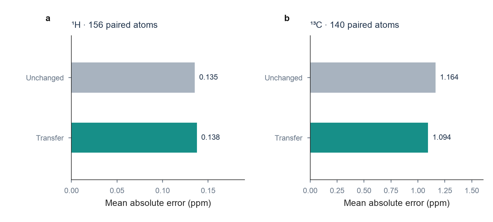

# 跨溶剂化学位移迁移

从源溶剂下的实测位移估计目标溶剂中的谱。

## 输入是什么

| Field | Meaning |
| --- | --- |
| `structure / nucleus` | 分子连接结构及 1H 或 13C 核种。 |
| `solvents` | 显式指定源溶剂与目标溶剂，且参考库包含对应配对。 |
| `source_ppm` | 源溶剂下的实测位移（ppm）。 |

## 输出是什么

| Field | Meaning |
| --- | --- |
| `target_ppm / delta_ppm` | 从独立参考记录估计目标位移及跨溶剂差值。 |
| `reference` | 参考分子、谱图/原子 ID、Tanimoto 相似度及排除规则。 |

## 真实运行案例

下面展示示例的输入、预测与参考。下载 JSON 可获取完整数值数组及更多示例。



[SVG](../assets/gallery/nmr-solvent_transfer.svg) · [PNG](../assets/gallery/nmr-solvent_transfer.png) · [Full input/output JSON](../assets/examples/nmr-solvent_transfer.json)

<details><summary>展开查看实际输入与输出字段</summary>

```json
{
  "input": {
    "nucleus": "1H",
    "source_ppm": 1.45,
    "source_solvent": "CD3OD",
    "target_solvent": "acetone-d6",
    "query_connectivity": "C1CCCCC1"
  },
  "output": {
    "source_ppm": 1.45,
    "predicted_target_ppm": 1.3799999999999997,
    "predicted_delta_ppm": -0.07000000000000028,
    "source_solvent": "CD3OD",
    "target_solvent": "acetone-d6",
    "nucleus": "1H",
    "query_connectivity": "C1CCCCC1",
    "reference": {
      "identity": "C1COCCO1",
      "molecule_id": "10016061",
      "atom_id": "10093018",
      "source_ppm": 3.66,
      "target_ppm": 3.59,
      "source_spectrum_ids": [
        "20197666"
      ],
      "target_spectrum_ids": [
        "20197080"
      ]
    },
    "tanimoto_similarity": 0.125,
    "same_connectivity_excluded": true,
    "method": "nearest_paired_experimental_reference_delta",
    "model_kind": "retrieval_baseline_not_neural_model",
    "query_molecule_id": "10811",
    "query_atom_id": "10046537",
    "target_reference_ppm": 1.43,
    "source_spectrum_ids": [
      "20197663"
    ],
    "target_spectrum_ids": [
      "20197659"
    ]
  }
}
```

</details>

## 实际评测结果

| Dataset / scope | Model / variant | Metric | Value |
| --- | --- | --- | ---: |
| recorded evaluation | 13C | atoms | 140 |
| recorded evaluation | 13C | molecules | 13 |
| recorded evaluation | 13C | mae_ppm | 1.09429 |
| recorded evaluation | 13C | unchanged_shift_mae_ppm | 1.16371 |
| recorded evaluation | 13C | rmse_ppm | 1.90935 |
| recorded evaluation | 1H | atoms | 156 |
| recorded evaluation | 1H | molecules | 19 |
| recorded evaluation | 1H | mae_ppm | 0.137628 |
| recorded evaluation | 1H | unchanged_shift_mae_ppm | 0.135385 |
| recorded evaluation | 1H | rmse_ppm | 0.376179 |

## 模型与方法

实验参考模型检索具有两种溶剂配对测量的相似分子环境，把参考中的溶剂位移差加到查询位移上，同时返回参考分子和原子编号。

分别使用 ppm 单位的 MAE 评估 H 与 C 位移。

## 复现方式

[Notebook with executed figures](../notebooks/nmr-solvent_transfer.ipynb) · [Quick Start](../quickstart.md)

```bash
python -m openmolspec_bench run --workspace /path/to/OpenMolSpec \
  --tasks nmr.solvent_transfer --limit 8 --output results/nmr-solvent_transfer-new.json
```

## 调用模型与微调

```python
from openmolspec.benchmark import Benchmark
benchmark = Benchmark(workspace='/path/to/workspace',
    python='/path/to/task-env/bin/python',
    solvent_library='/path/to/solvent-library.json')
result = benchmark.run('nmr.solvent_transfer', output='new-algorithm-results.json', limit=32)
```

此任务是算法流程，可调整参考库或匹配规则；没有神经网络参数和训练 loss。具体匹配目标与数据来源见上文。

<details><summary>来源报告与 SHA-256 指纹</summary>

- [solvent_transfer_reference32_20261116.json](https://github.com/jiaqingxie/openmolspec-studio-frontend/blob/release/openmolspec-v1/results/solvent_transfer_reference32_20261116.json) — SHA-256 `7532dc2b785a93aa51323934bb748b768f1bfc7c820809bc2065d0840afc543f`

</details>


[Model implementation / 模型实现](https://nmrshiftdb.nmr.uni-koeln.de/) · [Model review / 模型检查](../model-audit.md)

## 参考文献

- Steinbeck, C., Krause, S. & Kuhn, S. NMRShiftDB—Constructing a Free Chemical Information System with Open-Source Components. Journal of Chemical Information and Computer Sciences 43, 1733–1739 (2003). doi:10.1021/ci0341363. [Source](https://doi.org/10.1021/ci0341363)
