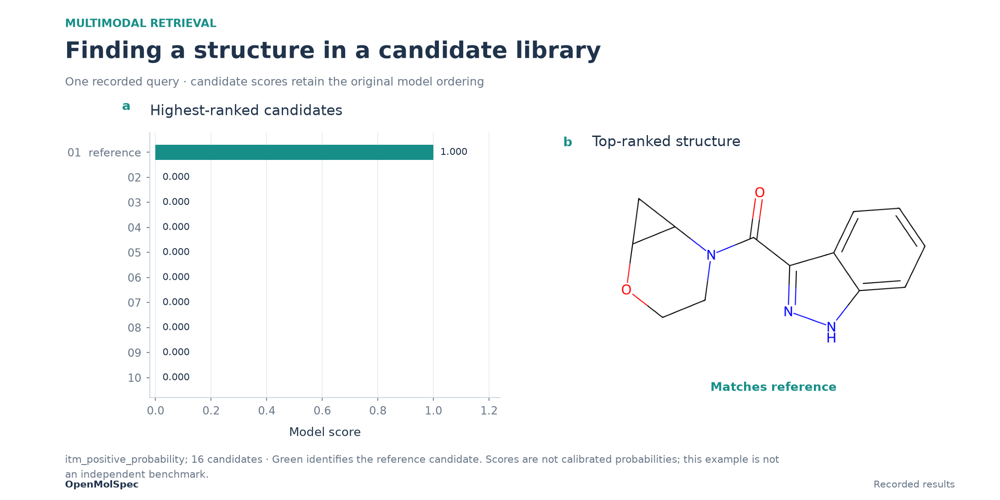

# IR + Raman + H/C + 候选 → ITM 重排

使用 Xinyu 保存的 Vib2Mol 模型完成结构检索、SMILES 生成或候选重排。完整输入为 IR+Raman+H/C；仅 IR/Raman 的路径作为缺核消融。

## 当前结论

完整四模态协议适配合理。候选池检索／ITM 不等于开放结构生成；需扩大独立候选库验证。

## 输入是什么

| Field | Meaning |
| --- | --- |
| `IR / Raman` | 每个可见通道 1024 个强度点，按 400→4000 cm⁻¹ 排列，并采用 checkpoint 的归一化。 |
| `1H / 13C` | 逐原子位移数组（ppm），参考 ID 和归一化必须与 checkpoint 一致。 |
| `candidate structures` | 明确提供候选结构库；模型只能在此库中排序。 |

## 输出是什么

| Field | Meaning |
| --- | --- |
| `ranking` | 候选结构 ID，以及相似度或 ITM 正类分数。 |
| `recall / MRR` | 排序指标、候选池大小及样本来源构成。 |

## 真实运行案例

下面展示记录中的第一例，不按结果好坏筛选。长数组预览会标明完整长度；完整数值可下载证据 JSON。参考标签与模型输入分开保留。



[SVG](../assets/gallery/spectroscopy-reranking-hc.svg) · [PNG](../assets/gallery/spectroscopy-reranking-hc.png) · [Full input/output JSON](../assets/examples/spectroscopy-reranking-hc.json)

<details><summary>展开查看实际输入与输出字段</summary>

```json
{
  "sample_id": "ZINCV2-ZINC000646741030",
  "input": {
    "ir": {
      "length": 1024,
      "first_values": [
        0.15220004320144653,
        0.190755695104599,
        0.2037702202796936,
        0.1804114133119583
      ]
    },
    "raman": {
      "length": 1024,
      "first_values": [
        0.04284051060676575,
        0.0596662312746048,
        0.059223152697086334,
        0.04435715824365616
      ]
    },
    "nmr_h_shifts_ppm": {
      "length": 13,
      "first_values": [
        0.40027499198913574,
        0.70107501745224,
        3.4114749431610107,
        3.4215750694274902
      ]
    },
    "nmr_c_shifts_ppm": {
      "length": 13,
      "first_values": [
        17.115774154663086,
        31.026575088500977,
        43.290775299072266,
        55.238773345947266
      ]
    }
  },
  "reference_smiles": "O=C(c1n[nH]c2ccccc12)N1CCOC2CC21",
  "ranked_candidates": {
    "length": 10,
    "first_values": [
      {
        "smiles": "O=C(c1n[nH]c2ccccc12)N1CCOC2CC21",
        "score": 0.9996222257614136,
        "reference_match": true
      },
      {
        "smiles": "O=C1CNc2nonc2N1",
        "score": 7.865002871199067e-09,
        "reference_match": false
      },
      {
        "smiles": "c1cnc2ncnc(NC3CCCC34CC4)c2c1",
        "score": 3.756063602505799e-12,
        "reference_match": false
      },
      {
        "smiles": "CC1NCCn2cnnc21",
        "score": 3.597697443777359e-12,
        "reference_match": false
      }
    ]
  }
}
```

</details>

## 实际评测结果

| Dataset / scope | Model / variant | Metric | Value |
| --- | --- | --- | ---: |
| recorded sample | recorded model | recall_at_1 | 1 |
| recorded sample | recorded model | mrr | 1 |
| recorded sample | recorded model | queries | 16 |
| recorded sample | recorded model | candidate_pool | 16 |

样本量和候选池随每次运行记录。图可能展示单个分子，表格是来源实验的实际汇总，不能混为同一统计范围。

## 模型与方法

复用原实现的 encode_spectra、canonical/unique_candidates 与 rerank_candidates。生成默认 beam=10、最大长度 300；先移除无效和重复规范结构，再对前 10 个候选用 ITM 正类概率重排。不提供分子式，也不使用近邻缓存回放。

检索报告双向 Recall@1/5/10、MRR 和候选池大小。生成同时报告原始 beam 的有效率、规范去重后的 top-1/3/5/10 及重排后的 top-k；重排始终使用明确的候选列表。

## 复现方式

[Notebook with executed figures](../notebooks/spectroscopy-reranking-hc.ipynb) · [Quick Start](../quickstart.md)

```bash
python -m openmolspec_bench run --workspace /path/to/OpenMolSpec \
  --tasks spectroscopy.reranking.hc --limit 8 --output results/spectroscopy-reranking-hc-new.json
```

## 边界与来源

生成与重排 checkpoint 的 H/C 参考和归一化缓冲必须一致。小候选池可能让检索分数偏高，必须公布样本 ID、种子和来源组成。

<details><summary>来源报告与 SHA-256 指纹</summary>

- [vibrational_ranked_examples_20261117.json](https://github.com/jiaqingxie/openmolspec-studio-frontend/blob/release/openmolspec-v1/results/vibrational_ranked_examples_20261117.json) — SHA-256 `b7e464aa11e85fdcae7245d987d92f272d6c1a5e47d697734df17d26731744e3`

</details>


[Original model / 原模型](https://github.com/X1nyuLu/openSpec-alpha) · [Model review / 模型检查](../model-audit.md)
