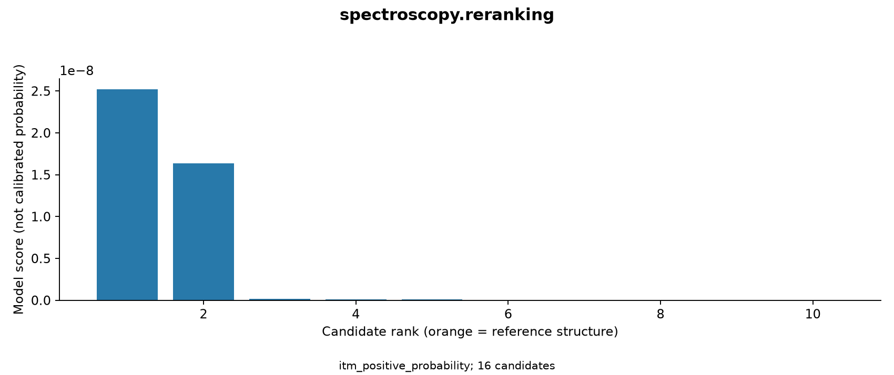

# Vib2Mol candidate reranking with IR/Raman only

Use Xinyu's saved Vib2Mol models for spectral structure elucidation. The complete input is IR + Raman + H/C; the IR/Raman-only route is a missing-NMR ablation.

## Current evidence

Missing-channel ablation of a four-modal checkpoint. Poor scores do not validate a stand-alone IR/Raman model; use compatible unimodal weights or plan separate adaptation.

## What goes in

| Field | Meaning |
| --- | --- |
| `IR / Raman` | 1024 intensity samples per visible channel, ordered 400→4000 cm⁻¹, using the checkpoint normalization. |
| `missing channels` | This uses a four-modal checkpoint with channels omitted; it is an ablation, not a separately trained model. |
| `candidate structures` | An explicit candidate library; scores cannot identify molecules outside it. |

## What comes out

| Field | Meaning |
| --- | --- |
| `ranking` | Candidate identities with similarity or ITM positive-class scores. |
| `recall / MRR` | Ranking metrics plus candidate-pool size and source composition. |

## A real recorded example

The first recorded example is shown below, regardless of whether it succeeds. Array previews explicitly state their lengths; download the evidence JSON for complete values. Reference labels are kept separate from model inputs.

```json
{
  "sample_id": "ZINCV2-ZINC000646741030",
  "input": {
    "ir": {
      "length": 1024,
      "first_values": [
        0.15220004320144653,
        0.190755695104599,
        0.2037702202796936,
        0.1804114133119583
      ]
    },
    "raman": {
      "length": 1024,
      "first_values": [
        0.04284051060676575,
        0.0596662312746048,
        0.059223152697086334,
        0.04435715824365616
      ]
    },
    "nmr_h_shifts_ppm": [],
    "nmr_c_shifts_ppm": []
  },
  "reference_smiles": "O=C(c1n[nH]c2ccccc12)N1CCOC2CC21",
  "ranked_candidates": {
    "length": 10,
    "first_values": [
      {
        "smiles": "O=C1CNc2nonc2N1",
        "score": 2.520129882555011e-08,
        "reference_match": false
      },
      {
        "smiles": "O=[N+]([O-])c1ccc2ncsc2c1",
        "score": 1.6378667311300887e-08,
        "reference_match": false
      },
      {
        "smiles": "O=C(Nc1nncs1)c1nccs1",
        "score": 1.6892409693269883e-10,
        "reference_match": false
      },
      {
        "smiles": "O=c1c2ccccc2ncn1-c1cccc2nsnc12",
        "score": 1.131930868480957e-10,
        "reference_match": false
      }
    ]
  }
}
```



[SVG](../assets/gallery/spectroscopy-reranking.svg) · [PNG](../assets/gallery/spectroscopy-reranking.png) · [Full input/output JSON](../assets/examples/spectroscopy-reranking.json)

## Actual evaluation results

| Dataset / scope | Model / variant | Metric | Value |
| --- | --- | --- | ---: |
| recorded sample | recorded model | recall_at_1 | 0.0625 |
| recorded sample | recorded model | mrr | 0.238472 |
| recorded sample | recorded model | queries | 16 |
| recorded sample | recorded model | candidate_pool | 16 |

Sample sizes and candidate pools belong to each run. The figure may show one molecule; the table reports the cited run, not a new benchmark on that molecule.

## Model and method

Reuse the authors' encode_spectra, canonical/unique_candidates and rerank_candidates utilities. Generation defaults to beam 10 and maximum length 300, removes invalid/duplicate canonical structures, and reranks up to 10 candidates by ITM positive-class probability. No molecular formula is supplied and no nearest-neighbor cache is used.

Retrieval reports both directions with the candidate-pool size and deterministic tie policy. Generation reports canonical top-1/3/5/10, validity across raw beams and reranked top-k separately. Reranking uses an explicit candidate list.

## Reproduce

[Notebook with executed figures](../notebooks/spectroscopy-reranking.ipynb) · [Quick Start](../quickstart.md)

```bash
python -m openmolspec_bench run --workspace /path/to/OpenMolSpec \
  --tasks spectroscopy.reranking --limit 8 --output results/spectroscopy-reranking-new.json
```

## Limits and provenance

Checkpoint pairs must share their H/C reference and normalization buffers. Small candidate pools can inflate retrieval numbers; publish the sample IDs, seed and source composition with every score.

- [vibrational_ranked_examples_20261117.json](https://github.com/jiaqingxie/openmolspec-studio-frontend/blob/release/openmolspec-v1/results/vibrational_ranked_examples_20261117.json) — SHA-256 `b7e464aa11e85fdcae7245d987d92f272d6c1a5e47d697734df17d26731744e3`

[Original model / 原模型](https://github.com/X1nyuLu/openSpec-alpha) · [Model review / 模型检查](../model-audit.md)
