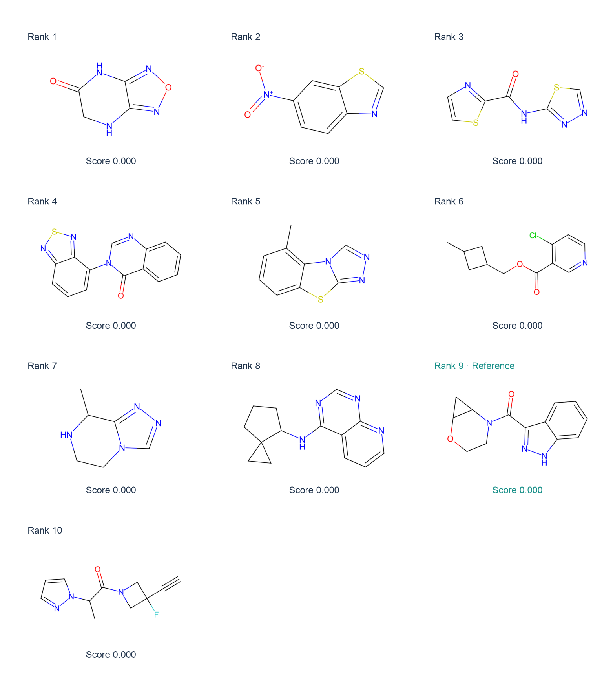

# 候选重排：IR + Raman

按候选结构与输入谱图的一致性进行排序。

## 输入是什么

| Field | Meaning |
| --- | --- |
| `IR / Raman` | 每个可见通道 1024 个强度点，按 400→4000 cm⁻¹ 排列，并采用 checkpoint 的归一化。 |
| `missing channels` | 输入掩码选择共享四模态权重的可见通道。 |
| `candidate structures` | 用于排序的分子候选库。 |

## 输出是什么

| Field | Meaning |
| --- | --- |
| `ranking` | 候选结构 ID，以及相似度或 ITM 正类分数。 |
| `recall / MRR` | 排序指标、候选池大小及样本来源构成。 |

## 真实运行案例

下面展示示例的输入、预测与参考。下载 JSON 可获取完整数值数组及更多示例。



[SVG](../assets/gallery/spectroscopy-reranking.svg) · [PNG](../assets/gallery/spectroscopy-reranking.png) · [Full input/output JSON](../assets/examples/spectroscopy-reranking.json)

<details><summary>展开查看实际输入与输出字段</summary>

```json
{
  "sample_id": "ZINCV2-ZINC000646741030",
  "input": {
    "ir": {
      "length": 1024,
      "first_values": [
        0.15220004320144653,
        0.190755695104599,
        0.2037702202796936,
        0.1804114133119583
      ]
    },
    "raman": {
      "length": 1024,
      "first_values": [
        0.04284051060676575,
        0.0596662312746048,
        0.059223152697086334,
        0.04435715824365616
      ]
    },
    "nmr_h_shifts_ppm": [],
    "nmr_c_shifts_ppm": []
  },
  "reference_smiles": "O=C(c1n[nH]c2ccccc12)N1CCOC2CC21",
  "ranked_candidates": {
    "length": 10,
    "first_values": [
      {
        "smiles": "O=C1CNc2nonc2N1",
        "score": 2.520129882555011e-08,
        "reference_match": false
      },
      {
        "smiles": "O=[N+]([O-])c1ccc2ncsc2c1",
        "score": 1.6378667311300887e-08,
        "reference_match": false
      },
      {
        "smiles": "O=C(Nc1nncs1)c1nccs1",
        "score": 1.6892409693269883e-10,
        "reference_match": false
      },
      {
        "smiles": "O=c1c2ccccc2ncn1-c1cccc2nsnc12",
        "score": 1.131930868480957e-10,
        "reference_match": false
      }
    ]
  }
}
```

</details>

## 实际评测结果

| Dataset / scope | Model / variant | Metric | Value |
| --- | --- | --- | ---: |
| recorded sample | recorded model | recall_at_1 | 0.0625 |
| recorded sample | recorded model | recall_at_5 | 0.375 |
| recorded sample | recorded model | recall_at_10 | 0.6875 |
| recorded sample | recorded model | mrr | 0.238472 |
| recorded sample | recorded model | queries | 16 |
| recorded sample | recorded model | candidate_pool | 16 |
| recorded sample | recorded model | unique_candidates | 16 |
| recorded sample | recorded model | tie_policy | stable_candidate_order |
| recorded sample | recorded model | top_1_hit_rate | 0.0625 |

## 模型与方法

openSpec 模型通过 Vib2Mol 编码谱通道。生成使用 beam search 和分子匹配分数；检索比较嵌入，候选重排使用匹配头。

生成报告 top-k 准确率，排序报告 Recall@k 与 MRR。

## 复现方式

[Notebook with executed figures](../notebooks/spectroscopy-reranking.ipynb) · [Quick Start](../quickstart.md)

```bash
python -m openmolspec_bench run --workspace /path/to/OpenMolSpec \
  --tasks spectroscopy.reranking --limit 8 --output results/spectroscopy-reranking-new.json
```

## 调用模型与微调

```python
from openmolspec.model import Vib2Mol
model = Vib2Mol(root='/path/to/portable-models',
    python='/path/to/vibrational-env/bin/python')
result = model.retrieve(inputs, candidate_smiles,
    rerank=True, allow_missing_modalities=True)
```

通过 [openSpec／Vib2Mol 作者训练流程](https://github.com/jiaqingxie/openmolspec-studio-frontend/tree/release/openmolspec-v1/documentation/assets/benchmarks)进行适配。准备谱—结构对齐的 LMDB，保留 H/C 参考和归一化，确保 train/val 分组独立。检索采用双向对比交叉熵与配对分类交叉熵；生成使用分子 token 自回归交叉熵。性质回归按其训练配置保留目标变换和回归准则。SDK 提供推理，相关训练通过作者实现执行。

$$L_{\rm retrieval}=L_{\rm contrastive}+L_{\rm matching},\qquad L_{\rm generation}=-\sum_t\log p(y_t\mid y_{<t},s).$$

<details><summary>来源报告与 SHA-256 指纹</summary>

- [vibrational_ranked_examples_20261117.json](https://github.com/jiaqingxie/openmolspec-studio-frontend/blob/release/openmolspec-v1/results/vibrational_ranked_examples_20261117.json) — SHA-256 `b7e464aa11e85fdcae7245d987d92f272d6c1a5e47d697734df17d26731744e3`

</details>


[Model implementation / 模型实现](https://github.com/jiaqingxie/openmolspec-studio-frontend/tree/release/openmolspec-v1/documentation/assets/benchmarks) · [Model review / 模型检查](../model-audit.md)

## 参考文献

- OpenMolSpec contributors. openSpec models and benchmark training workflows. Source archive, v1.0 (2026). [Source](https://github.com/jiaqingxie/openmolspec-studio-frontend/tree/release/openmolspec-v1/documentation/assets/benchmarks)
- OpenMolSpec contributors. OpenMolSpec: Chemical spectroscopy datasets, models and learning workflows. Software release v1.0 (2026). [Source](https://github.com/jiaqingxie/openmolspec-studio-frontend/releases/tag/v1.0)
- Yuan, M., Zou, Z. & Hu, W. QMe14S, A Comprehensive and Efficient Spectral Dataset for Small Organic Molecules. arXiv:2501.18876 (2025). [Source](https://arxiv.org/abs/2501.18876)
- Zou, Z., Zhang, Y., Liang, L., Wei, M., Leng, J., Jiang, J., Luo, Y. & Hu, W. A deep learning model for predicting selected organic molecular spectra. Nature Computational Science 3, 957–964 (2023). doi:10.1038/s43588-023-00550-y. [Source](https://www.nature.com/articles/s43588-023-00550-y)
