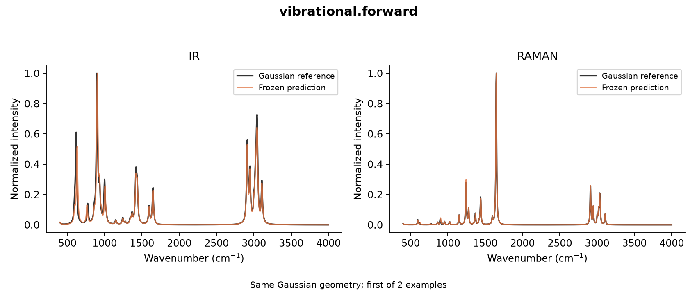

# 构象 → IR / Raman

从固定分子构象预测 IR/Raman，复用 Xinyu openSpec 项目的 Equiformer-v3 Hessian 和 response 权重。

## 当前结论

使用正确的 Xinyu Hessian/response 路径及成对几何。两例只证明流程执行；先做独立构象集评测。

## 输入是什么

| Field | Meaning |
| --- | --- |
| `geometry` | 元素列表及 N×3 笛卡尔坐标（Å），与参考谱取自同一份 Gaussian 日志。 |
| `checkpoints` | Xinyu openSpec 的 Equiformer-v3 Hessian Hi/Hij 及偶极矩/极化率导数权重。 |

## 输出是什么

| Field | Meaning |
| --- | --- |
| `IR / Raman` | 400–4000 cm⁻¹、1024 点共同网格上的两条归一化强度数组。 |
| `spectral error` | 与成对计算参考谱比较的分通道余弦相似度及强度 MAE。 |

## 真实运行案例

下面展示记录中的第一例，不按结果好坏筛选。长数组预览会标明完整长度；完整数值可下载证据 JSON。参考标签与模型输入分开保留。

```json
{
  "sample_id": "NISTIR-11730",
  "input": {
    "gaussian_log": "NISTIR-11730.log",
    "sha256": "894857d2c85d7106e5613540c593ff5a2ca3e2c90bed289575d38227086c2df1",
    "atoms": 13
  },
  "output": {
    "wavenumber_cm1": {
      "length": 1024,
      "first_values": [
        400.0,
        403.5190734863281,
        407.0381164550781,
        410.55718994140625
      ]
    },
    "predicted_ir": {
      "length": 1024,
      "first_values": [
        0.01742994412779808,
        0.013713346794247627,
        0.011153731495141983,
        0.009342214092612267
      ]
    },
    "predicted_raman": {
      "length": 1024,
      "first_values": [
        0.009821882471442223,
        0.007297216448932886,
        0.005653610453009605,
        0.004528572782874107
      ]
    }
  },
  "reference": {
    "reference_ir": {
      "length": 1024,
      "first_values": [
        0.01633988507091999,
        0.013211564160883427,
        0.011014701798558235,
        0.009432419203221798
      ]
    },
    "reference_raman": {
      "length": 1024,
      "first_values": [
        0.007780710235238075,
        0.005948643200099468,
        0.004715456161648035,
        0.0038486106786876917
      ]
    }
  },
  "metrics": {
    "ir_cosine_similarity": 0.9578531980514526,
    "ir_mae": 0.009397805668413639,
    "raman_cosine_similarity": 0.9989054203033447,
    "raman_mae": 0.0008200838346965611
  }
}
```



[SVG](../assets/gallery/vibrational-forward.svg) · [PNG](../assets/gallery/vibrational-forward.png) · [Full input/output JSON](../assets/examples/vibrational-forward.json)

## 实际评测结果

| Dataset / scope | Model / variant | Metric | Value |
| --- | --- | --- | ---: |
| recorded sample | recorded model | ir_cosine_similarity | 0.977503 |
| recorded sample | recorded model | raman_cosine_similarity | 0.990194 |

样本量和候选池随每次运行记录。图可能展示单个分子，表格是来源实验的实际汇总，不能混为同一统计范围。

## 模型与方法

坐标与参考谱必须来自同一 Gaussian 日志；检查 XYZ 加载后坐标不变，预测 Hessian/响应导数，再经振动模和展宽重建谱图。

预测与参考均使用 400–4000 cm⁻¹ 的 1024 点轴和 min-max 强度归一化，分别报告 IR/Raman 的余弦相似度及强度 MAE。

## 复现方式

[Notebook with executed figures](../notebooks/vibrational-forward.ipynb) · [Quick Start](../quickstart.md)

```bash
python -m openmolspec_bench run --workspace /path/to/OpenMolSpec \
  --tasks vibrational.forward --limit 8 --output results/vibrational-forward-new.json
```

## 边界与来源

默认两个真实 Gaussian 日志仅用于配对运行检查，未审计其独立测试身份。不能用新生成的 RDKit 构象代替原参考几何后宣称是严格配对精度。

- [vibrational_forward_paired_logs_20261116.json](https://github.com/jiaqingxie/openmolspec-studio-frontend/blob/release/openmolspec-v1/results/vibrational_forward_paired_logs_20261116.json) — SHA-256 `3e35b2c5b0c5b83715f49397e9d3ab5a744429ec90bff2551a96ea0d1641e087`

[Original model / 原模型](https://github.com/X1nyuLu/openSpec-alpha) · [Model review / 模型检查](../model-audit.md)
