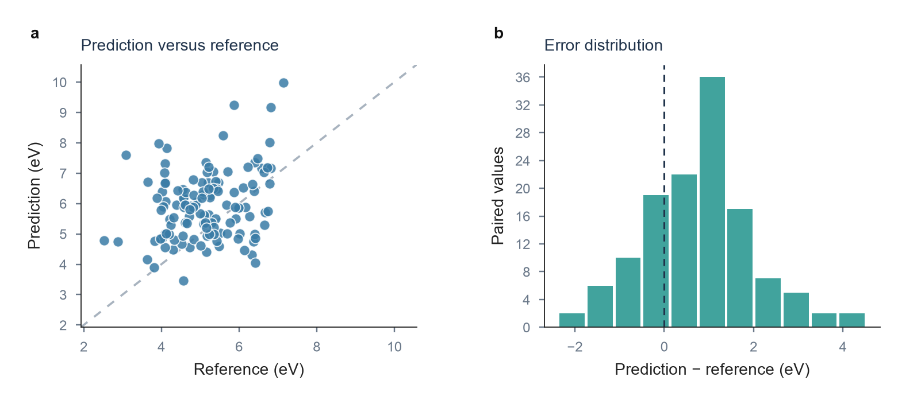

# HOMO–LUMO gap from IR

[Gap benchmark](../benchmarks/vibrational.md) with 1,024 four-spectrum examples and 3,381 examples for the partial-input models.

Estimate the molecular HOMO–LUMO energy gap from spectra.

## Vibrational-only regression

With IR and no NMR, the software selects a regressor fitted to these vibrational inputs. A new connectivity-disjoint split of the packaged theoretical spectra contains 11,568 training, 1,651 validation and 3,381 test molecules. Test MAE is 0.382 eV versus 0.749 eV for the training mean. The original 128 queries were separately reserved and give 0.428 eV MAE. The historical figures below show the four-channel checkpoint with inputs masked.

## What goes in

| Field | Meaning |
| --- | --- |
| `IR / Raman` | 1024 intensity samples per visible channel, ordered 400→4000 cm⁻¹, using the checkpoint normalization. |
| `model selection` | The observed vibrational channels select the corresponding fitted gap regressor. |

## What comes out

| Field | Meaning |
| --- | --- |
| `gap_ev` | One predicted HOMO–LUMO gap in eV; source Hartree labels are converted once. |
| `MAE / baseline` | Error against reference and the frozen training-mean constant on the same records. |

## A real recorded example

Inspect the input, prediction and reference for the example below. Download the JSON for the complete numerical arrays and additional examples.



[SVG](../assets/gallery/vibrational-gap-ir.svg) · [PNG](../assets/gallery/vibrational-gap-ir.png) · [Full input/output JSON](../assets/examples/vibrational-gap-ir.json)

<details><summary>Inspect the actual input and output fields</summary>

```json
{
  "sample_id": "ZINCV2-ZINC000666646493",
  "output": {
    "gap_ev": 5.634759166292478
  },
  "reference": {
    "gap_ev": 5.227035183991835
  },
  "input": {
    "ir": {
      "length": 1024,
      "first_values": [
        0.010713187977671623,
        0.013313207775354385,
        0.017257077619433403,
        0.021930798888206482
      ]
    }
  }
}
```

</details>

## Earlier evaluation of the four-channel model with missing spectra

| Dataset / scope | Model / variant | Metric | Value |
| --- | --- | --- | ---: |
| recorded sample | recorded model | mae_ev | 1.17771 |
| recorded sample | recorded model | rmse_ev | 1.47487 |
| recorded sample | recorded model | examples | 128 |
| recorded sample | Training-mean baseline | constant_ev | 5.64512 |
| recorded sample | Training-mean baseline | mae_ev | 0.89994 |
| recorded sample | Training-mean baseline | rmse_ev | 1.06962 |
| recorded sample | Training-mean baseline | examples | 128 |

## Model and method

A ridge regressor fits pooled vibrational intensities and similarities to reference spectra. The model for the observed channels predicts the energy gap in eV.

Report MAE and RMSE in eV.

## Reproduce

[Notebook with executed figures](../notebooks/vibrational-gap-ir.ipynb) · [Quick Start](../quickstart.md)

```bash
python -m openmolspec_bench run --workspace /path/to/OpenMolSpec \
  --tasks vibrational.gap.ir --limit 8 --output results/vibrational-gap-ir-new.json
```

## Call and adapt this model

```python
from openmolspec.model import GapModel
model = GapModel(root='/path/to/portable-models',
    python='/path/to/vibrational-env/bin/python')
result = model.predict(inputs, allow_missing_modalities=True)
```

Use the [openSpec/Vib2Mol author training workflow](https://github.com/jiaqingxie/openmolspec-studio-frontend/tree/release/openmolspec-v1/documentation/assets/benchmarks) for adaptation. Export aligned spectral/structure LMDBs, retain H/C references and normalization, and keep train/validation groups disjoint. Retrieval combines symmetric contrastive cross-entropy with matching cross-entropy; generation adds autoregressive molecular-token cross-entropy. Property regression uses the target transform and regression criterion from its training configuration. SDK classes expose inference; these training workflows run in the author implementation. The current Vib2Conf property engine uses mean SmoothL1 loss on training-normalized targets; its configurable beta is positive and defaults to 1. Retain the training mean/std for validation and inference.

$$\ell_\beta(r)=\begin{cases}r^2/(2\beta),&|r|<\beta,\\ |r|-\beta/2,&|r|\ge\beta.\end{cases}$$

$$L_{\rm gap}=\frac1N\sum_i\ell_\beta\left(\hat z_i-\frac{y_i-\mu_{\rm train}}{\sigma_{\rm train}}\right).$$

<details><summary>Source reports and SHA-256 fingerprints</summary>

- [gap_protocol_random128_20261116.json](https://github.com/jiaqingxie/openmolspec-studio-frontend/blob/release/openmolspec-v1/results/gap_protocol_random128_20261116.json) — SHA-256 `e3ab614192106dccc2bb4cf30d4a2ce0259ba6e21207bb52695a0a02ef08d488`

</details>


[Model implementation / 模型实现](https://github.com/jiaqingxie/openmolspec-studio-frontend/tree/release/openmolspec-v1/documentation/assets/benchmarks) · [Model review / 模型检查](../model-audit.md)

## References

- OpenMolSpec contributors. openSpec models and benchmark training workflows. Source archive, v1.0 (2026). [Source](https://github.com/jiaqingxie/openmolspec-studio-frontend/tree/release/openmolspec-v1/documentation/assets/benchmarks)
- OpenMolSpec contributors. OpenMolSpec: Chemical spectroscopy datasets, models and learning workflows. Software release v1.0 (2026). [Source](https://github.com/jiaqingxie/openmolspec-studio-frontend/releases/tag/v1.0)
- Yuan, M., Zou, Z. & Hu, W. QMe14S, A Comprehensive and Efficient Spectral Dataset for Small Organic Molecules. arXiv:2501.18876 (2025). [Source](https://arxiv.org/abs/2501.18876)
- Zou, Z., Zhang, Y., Liang, L., Wei, M., Leng, J., Jiang, J., Luo, Y. & Hu, W. A deep learning model for predicting selected organic molecular spectra. Nature Computational Science 3, 957–964 (2023). doi:10.1038/s43588-023-00550-y. [Source](https://www.nature.com/articles/s43588-023-00550-y)
