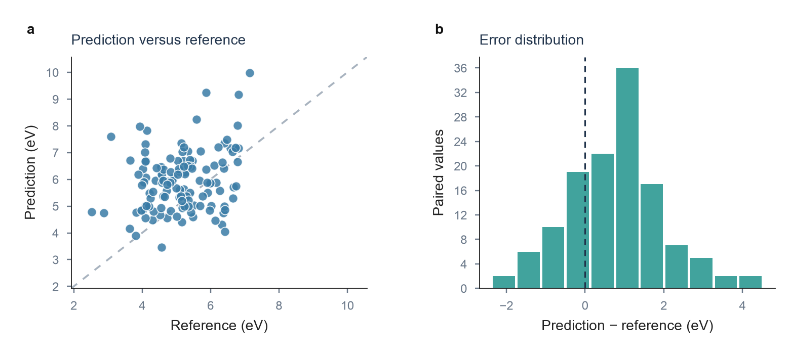

# 由 IR 预测 HOMO–LUMO 能隙

[能隙评测](../benchmarks/vibrational.md)收录了 1,024 条四谱输入和 3,381 条缺通道模型的结果。

根据谱图估计分子的 HOMO–LUMO 能隙。

## 仅用振动谱的回归模型

输入 IR 且没有 NMR 时，软件使用专门训练的谱到能隙回归模型。在 OpenMolSpec 理论谱上重新按连通结构划分，训练 11,568 种分子，验证 1,651 种，测试 3,381 种。测试 MAE 为 0.382 eV，训练均值对照为 0.749 eV。历史 128 个查询单独留出，回测 MAE 为 0.428 eV。下方原始图表记录四通道模型屏蔽输入后的表现。

## 输入是什么

| Field | Meaning |
| --- | --- |
| `IR / Raman` | 每个可见通道 1024 个强度点，按 400→4000 cm⁻¹ 排列，并采用 checkpoint 的归一化。 |
| `model selection` | 根据提供的振动谱通道选择相应的能隙回归模型。 |

## 输出是什么

| Field | Meaning |
| --- | --- |
| `gap_ev` | 一个 HOMO–LUMO gap 预测值（eV）；原始 Hartree 标签仅转换一次。 |
| `MAE / baseline` | 与参考值的误差，以及相同样本上固定训练均值基线的误差。 |

## 真实运行案例

下面展示示例的输入、预测与参考。下载 JSON 可获取完整数值数组及更多示例。



[SVG](../assets/gallery/vibrational-gap-ir.svg) · [PNG](../assets/gallery/vibrational-gap-ir.png) · [Full input/output JSON](../assets/examples/vibrational-gap-ir.json)

<details><summary>展开查看实际输入与输出字段</summary>

```json
{
  "sample_id": "ZINCV2-ZINC000666646493",
  "output": {
    "gap_ev": 5.634759166292478
  },
  "reference": {
    "gap_ev": 5.227035183991835
  },
  "input": {
    "ir": {
      "length": 1024,
      "first_values": [
        0.010713187977671623,
        0.013313207775354385,
        0.017257077619433403,
        0.021930798888206482
      ]
    }
  }
}
```

</details>

## 较早的四通道模型缺谱评测

| Dataset / scope | Model / variant | Metric | Value |
| --- | --- | --- | ---: |
| recorded sample | recorded model | mae_ev | 1.17771 |
| recorded sample | recorded model | rmse_ev | 1.47487 |
| recorded sample | recorded model | examples | 128 |
| recorded sample | Training-mean baseline | constant_ev | 5.64512 |
| recorded sample | Training-mean baseline | mae_ev | 0.89994 |
| recorded sample | Training-mean baseline | rmse_ev | 1.06962 |
| recorded sample | Training-mean baseline | examples | 128 |

## 模型与方法

岭回归模型使用合并频段后的振动谱强度及与参考谱的相似度。软件根据输入通道选择模型，输出单位为 eV。

报告以 eV 为单位的 MAE 与 RMSE。

## 复现方式

[Notebook with executed figures](../notebooks/vibrational-gap-ir.ipynb) · [Quick Start](../quickstart.md)

```bash
python -m openmolspec_bench run --workspace /path/to/OpenMolSpec \
  --tasks vibrational.gap.ir --limit 8 --output results/vibrational-gap-ir-new.json
```

## 调用模型与微调

```python
from openmolspec.model import GapModel
model = GapModel(root='/path/to/portable-models',
    python='/path/to/vibrational-env/bin/python')
result = model.predict(inputs, allow_missing_modalities=True)
```

通过 [openSpec／Vib2Mol 作者训练流程](https://github.com/jiaqingxie/openmolspec-studio-frontend/tree/release/openmolspec-v1/documentation/assets/benchmarks)进行适配。准备谱—结构对齐的 LMDB，保留 H/C 参考和归一化，确保 train/val 分组独立。检索采用双向对比交叉熵与配对分类交叉熵；生成使用分子 token 自回归交叉熵。性质回归按其训练配置保留目标变换和回归准则。SDK 提供推理，相关训练通过作者实现执行。 当前 Vib2Conf 性质引擎对训练集标准化目标使用平均 SmoothL1；beta 为正数，默认 1。验证与推理使用相同的训练均值和标准差。

$$\ell_\beta(r)=\begin{cases}r^2/(2\beta),&|r|<\beta,\\ |r|-\beta/2,&|r|\ge\beta.\end{cases}$$

$$L_{\rm gap}=\frac1N\sum_i\ell_\beta\left(\hat z_i-\frac{y_i-\mu_{\rm train}}{\sigma_{\rm train}}\right).$$

<details><summary>来源报告与 SHA-256 指纹</summary>

- [gap_protocol_random128_20261116.json](https://github.com/jiaqingxie/openmolspec-studio-frontend/blob/release/openmolspec-v1/results/gap_protocol_random128_20261116.json) — SHA-256 `e3ab614192106dccc2bb4cf30d4a2ce0259ba6e21207bb52695a0a02ef08d488`

</details>


[Model implementation / 模型实现](https://github.com/jiaqingxie/openmolspec-studio-frontend/tree/release/openmolspec-v1/documentation/assets/benchmarks) · [Model review / 模型检查](../model-audit.md)

## 参考文献

- OpenMolSpec contributors. openSpec models and benchmark training workflows. Source archive, v1.0 (2026). [Source](https://github.com/jiaqingxie/openmolspec-studio-frontend/tree/release/openmolspec-v1/documentation/assets/benchmarks)
- OpenMolSpec contributors. OpenMolSpec: Chemical spectroscopy datasets, models and learning workflows. Software release v1.0 (2026). [Source](https://github.com/jiaqingxie/openmolspec-studio-frontend/releases/tag/v1.0)
- Yuan, M., Zou, Z. & Hu, W. QMe14S, A Comprehensive and Efficient Spectral Dataset for Small Organic Molecules. arXiv:2501.18876 (2025). [Source](https://arxiv.org/abs/2501.18876)
- Zou, Z., Zhang, Y., Liang, L., Wei, M., Leng, J., Jiang, J., Luo, Y. & Hu, W. A deep learning model for predicting selected organic molecular spectra. Nature Computational Science 3, 957–964 (2023). doi:10.1038/s43588-023-00550-y. [Source](https://www.nature.com/articles/s43588-023-00550-y)
