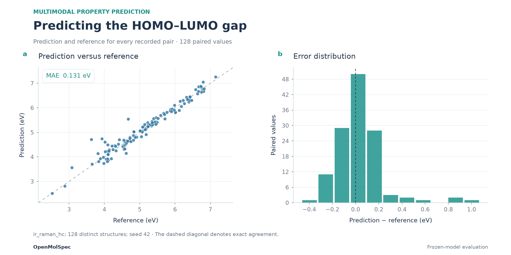

# IR + Raman + H/C NMR → HOMO–LUMO gap

由谱图预测 HOMO–LUMO gap，使用已有共享谱学 Transformer，输出 eV。

## 当前结论

完整输入和单位已对齐；128 样本 MAE 0.131446 eV，优于均值基线 0.899940 eV。下一步是更大独立评测，无证据要求立即微调。

## 输入是什么

| Field | Meaning |
| --- | --- |
| `IR / Raman` | 每个可见通道 1024 个强度点，按 400→4000 cm⁻¹ 排列，并采用 checkpoint 的归一化。 |
| `1H / 13C` | 逐原子位移数组（ppm），参考 ID 和归一化必须与 checkpoint 一致。 |

## 输出是什么

| Field | Meaning |
| --- | --- |
| `gap_ev` | 一个 HOMO–LUMO gap 预测值（eV）；原始 Hartree 标签仅转换一次。 |
| `MAE / baseline` | 与参考值的误差，以及相同样本上固定训练均值基线的误差。 |

## 真实运行案例

下面展示记录中的第一例，不按结果好坏筛选。长数组预览会标明完整长度；完整数值可下载证据 JSON。参考标签与模型输入分开保留。



[SVG](../assets/gallery/vibrational-gap-ir_raman_hc.svg) · [PNG](../assets/gallery/vibrational-gap-ir_raman_hc.png) · [Full input/output JSON](../assets/examples/vibrational-gap-ir_raman_hc.json)

<details><summary>展开查看实际输入与输出字段</summary>

```json
{
  "sample_id": "ZINCV2-ZINC000666646493",
  "output": {
    "gap_ev": 5.394753155772362
  },
  "reference": {
    "gap_ev": 5.227035183991835
  },
  "input": {
    "ir": {
      "length": 1024,
      "first_values": [
        0.010713187977671623,
        0.013313207775354385,
        0.017257077619433403,
        0.021930798888206482
      ]
    },
    "raman": {
      "length": 1024,
      "first_values": [
        0.007774287834763527,
        0.010057443752884865,
        0.0145131079480052,
        0.01943223364651203
      ]
    },
    "nmr_h_shifts_ppm": {
      "length": 17,
      "first_values": [
        0.18957500159740448,
        0.6601750254631042,
        0.8606749773025513,
        1.1248749494552612
      ]
    },
    "nmr_c_shifts_ppm": {
      "length": 13,
      "first_values": [
        12.30097484588623,
        12.40257453918457,
        13.135274887084961,
        18.714975357055664
      ]
    },
    "nmr_reference_id": "tms-d6273f14fda3cb5e"
  }
}
```

</details>

## 实际评测结果

| Dataset / scope | Model / variant | Metric | Value |
| --- | --- | --- | ---: |
| recorded sample | recorded model | mae_ev | 0.131446 |
| recorded sample | recorded model | rmse_ev | 0.205964 |
| recorded sample | recorded model | examples | 128 |
| recorded sample | Training-mean baseline | mae_ev | 0.89994 |
| recorded sample | Training-mean baseline | rmse_ev | 1.06962 |
| recorded sample | Training-mean baseline | examples | 128 |

样本量和候选池随每次运行记录。图可能展示单个分子，表格是来源实验的实际汇总，不能混为同一统计范围。

## 模型与方法

该 checkpoint 的训练模态是 IR+Raman+H/C。完整输入配置提供四种谱；IR-only、Raman-only 和 IR+Raman 是同一模型的缺通道消融，不是独立训练的单谱模型。

原 Vib2Mol LMDB 的 gap 为 Hartree，仅乘一次 27.211386245988 转 eV。模型输出按 checkpoint 保存的均值和标准差反归一化，H/C 使用权重内的中心、尺度与参考 ID。报告 MAE/RMSE，并在相同样本上报告训练均值常量基线。

## 复现方式

[Notebook with executed figures](../notebooks/vibrational-gap-ir_raman_hc.ipynb) · [Quick Start](../quickstart.md)

```bash
python -m openmolspec_bench run --workspace /path/to/OpenMolSpec \
  --tasks vibrational.gap.ir_raman_hc --limit 8 --output results/vibrational-gap-ir_raman_hc-new.json
```

## 边界与来源

按文件顺序的首批样本可能来源偏倚，较广的检查使用固定种子的 reservoir 抽样。缺通道与完整输入的成绩必须分开解释。

<details><summary>来源报告与 SHA-256 指纹</summary>

- [gap_protocol_random128_20261116.json](https://github.com/jiaqingxie/openmolspec-studio-frontend/blob/release/openmolspec-v1/results/gap_protocol_random128_20261116.json) — SHA-256 `e3ab614192106dccc2bb4cf30d4a2ce0259ba6e21207bb52695a0a02ef08d488`

</details>


[Original model / 原模型](https://github.com/X1nyuLu/openSpec-alpha) · [Model review / 模型检查](../model-audit.md)
