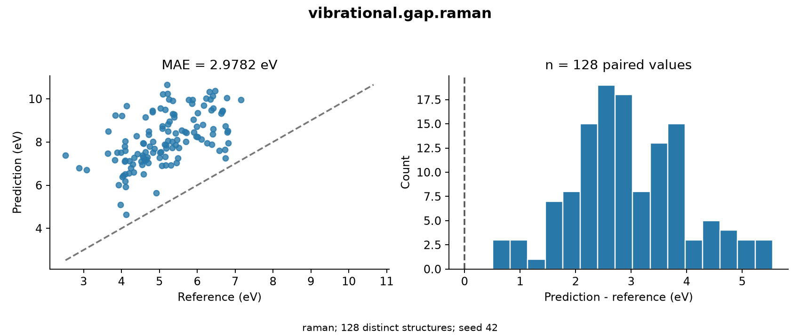

# HOMO–LUMO gap prediction: RAMAN

Predict the molecular HOMO–LUMO gap in eV from spectral inputs, using the existing shared spectroscopy Transformer.

## Current evidence

Missing-channel ablation of a four-modal checkpoint. Poor scores do not validate a stand-alone IR/Raman model; use compatible unimodal weights or plan separate adaptation.

## What goes in

| Field | Meaning |
| --- | --- |
| `IR / Raman` | 1024 intensity samples per visible channel, ordered 400→4000 cm⁻¹, using the checkpoint normalization. |
| `missing channels` | This uses a four-modal checkpoint with channels omitted; it is an ablation, not a separately trained model. |

## What comes out

| Field | Meaning |
| --- | --- |
| `gap_ev` | One predicted HOMO–LUMO gap in eV; source Hartree labels are converted once. |
| `MAE / baseline` | Error against reference and the frozen training-mean constant on the same records. |

## A real recorded example

The first recorded example is shown below, regardless of whether it succeeds. Array previews explicitly state their lengths; download the evidence JSON for complete values. Reference labels are kept separate from model inputs.

```json
{
  "sample_id": "ZINCV2-ZINC000666646493",
  "output": {
    "gap_ev": 8.8157206550655
  },
  "reference": {
    "gap_ev": 5.227035183991835
  },
  "input": {
    "raman": {
      "length": 1024,
      "first_values": [
        0.007774287834763527,
        0.010057443752884865,
        0.0145131079480052,
        0.01943223364651203
      ]
    }
  }
}
```



[SVG](../assets/gallery/vibrational-gap-raman.svg) · [PNG](../assets/gallery/vibrational-gap-raman.png) · [Full input/output JSON](../assets/examples/vibrational-gap-raman.json)

## Actual evaluation results

| Dataset / scope | Model / variant | Metric | Value |
| --- | --- | --- | ---: |
| recorded sample | recorded model | mae_ev | 2.97818 |
| recorded sample | recorded model | rmse_ev | 3.15661 |
| recorded sample | recorded model | examples | 128 |
| recorded sample | Training-mean baseline | mae_ev | 0.89994 |
| recorded sample | Training-mean baseline | rmse_ev | 1.06962 |
| recorded sample | Training-mean baseline | examples | 128 |

Sample sizes and candidate pools belong to each run. The figure may show one molecule; the table reports the cited run, not a new benchmark on that molecule.

## Model and method

The checkpoint was trained for ir-raman-nmr inputs. Complete-input evaluation supplies both IR/Raman and H/C peaks. Other variants deliberately omit channels and are ablations of the same four-modality checkpoint, not separately trained unimodal models.

The bundled Vib2Mol LMDB stores gap in Hartree; convert it once to eV using 27.211386245988. The prediction is unnormalized with the checkpoint's stored target mean/std. H/C normalization and reference must agree with the checkpoint. Report MAE/RMSE and the fixed training-mean baseline on exactly the same records.

## Reproduce

[Notebook with executed figures](../notebooks/vibrational-gap-raman.ipynb) · [Quick Start](../quickstart.md)

```bash
python -m openmolspec_bench run --workspace /path/to/OpenMolSpec \
  --tasks vibrational.gap.raman --limit 8 --output results/vibrational-gap-raman-new.json
```

## Limits and provenance

A small first-record sample may be biased by source order. Use seeded reservoir sampling for broader checks; missing-channel scores must remain separate from complete-input scores.

- [gap_protocol_random128_20261116.json](https://github.com/jiaqingxie/openmolspec-studio-frontend/blob/release/openmolspec-v1/results/gap_protocol_random128_20261116.json) — SHA-256 `e3ab614192106dccc2bb4cf30d4a2ce0259ba6e21207bb52695a0a02ef08d488`

[Original model / 原模型](https://github.com/X1nyuLu/openSpec-alpha) · [Model review / 模型检查](../model-audit.md)
