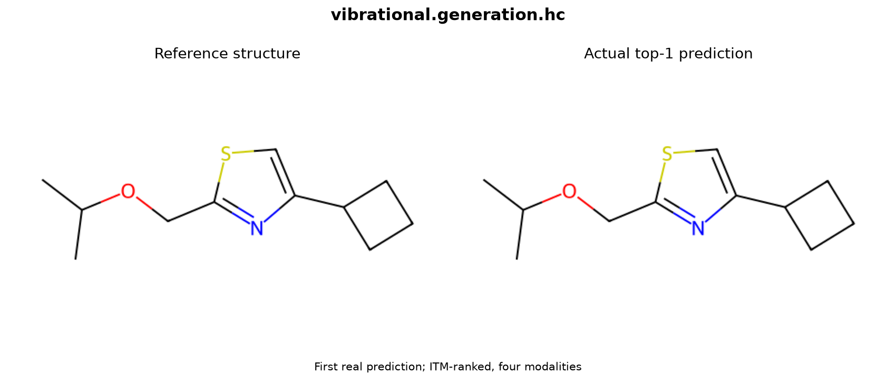

# Vib2Mol generation with H/C

Use Xinyu's saved Vib2Mol models for spectral structure elucidation. The complete input is IR + Raman + H/C; the IR/Raman-only route is a missing-NMR ablation.

## Current evidence

Author generation protocol is implemented. ITM reranking lowers top-1 from 0.75 to 0.6875 on the same 64 examples; validate this regression before adapting the ranker.

## What goes in

| Field | Meaning |
| --- | --- |
| `IR / Raman` | 1024 intensity samples per visible channel, ordered 400→4000 cm⁻¹, using the checkpoint normalization. |
| `1H / 13C` | Per-atom shift arrays in ppm with the checkpoint-compatible reference ID and normalization. |

## What comes out

| Field | Meaning |
| --- | --- |
| `SMILES candidates` | Decoded valid, canonical unique candidates; full-input route uses beam 10 and ITM reranking. |
| `top-k` | Generation and reranking scores are separate. No molecular formula is supplied. |

## A real recorded example

The first recorded example is shown below, regardless of whether it succeeds. Array previews explicitly state their lengths; download the evidence JSON for complete values. Reference labels are kept separate from model inputs.

```json
{
  "target": "CC(C)OCC1=NC(C2CCC2)=CS1",
  "raw_beams": {
    "length": 10,
    "first_values": [
      "CC(C)OCC1=NC(C2CCC2)=CS1",
      "CC(OCC1=NC(=CS1)C1CCC1)C",
      "CC(OCC1=NC(C2CCC2)=CS1)C",
      "CC(OCC1SC=C(N=1)C1CCC1)C"
    ]
  },
  "unique_candidates": [
    "CC(C)OCC1=NC(C2CCC2)=CS1"
  ],
  "reranked": [
    "CC(C)OCC1=NC(C2CCC2)=CS1"
  ],
  "positive_probabilities": [
    0.9998494386672974
  ],
  "input": {
    "ir": {
      "length": 1024,
      "first_values": [
        0.005309805274009705,
        0.005845691077411175,
        0.006656948011368513,
        0.007852676324546337
      ]
    },
    "raman": {
      "length": 1024,
      "first_values": [
        0.004348924849182367,
        0.0044013503938913345,
        0.0046332464553415775,
        0.005103452131152153
      ]
    },
    "nmr_h_shifts_ppm": {
      "length": 17,
      "first_values": [
        0.8246750235557556,
        0.8999750018119812,
        0.9729750156402588,
        1.1875749826431274
      ]
    },
    "nmr_c_shifts_ppm": {
      "length": 11,
      "first_values": [
        19.662874221801758,
        20.252174377441406,
        22.792875289916992,
        26.529874801635742
      ]
    },
    "nmr_reference_id": "tms-d6273f14fda3cb5e"
  }
}
```



[SVG](../assets/gallery/vibrational-generation-hc.svg) · [PNG](../assets/gallery/vibrational-generation-hc.png) · [Full input/output JSON](../assets/examples/vibrational-generation-hc.json)

## Actual evaluation results

| Dataset / scope | Model / variant | Metric | Value |
| --- | --- | --- | ---: |
| recorded sample | recorded model | exact_canonical_top1 | 0.75 |
| recorded sample | recorded model | exact_canonical_top5 | 0.890625 |
| recorded sample | recorded model | valid_smiles_fraction | 0.959375 |
| recorded sample | recorded model | examples | 64 |
| recorded sample | ITM reranked | exact_canonical_top1 | 0.6875 |
| recorded sample | ITM reranked | exact_canonical_top5 | 0.890625 |

Sample sizes and candidate pools belong to each run. The figure may show one molecule; the table reports the cited run, not a new benchmark on that molecule.

## Model and method

Reuse the authors' encode_spectra, canonical/unique_candidates and rerank_candidates utilities. Generation defaults to beam 10 and maximum length 300, removes invalid/duplicate canonical structures, and reranks up to 10 candidates by ITM positive-class probability. No molecular formula is supplied and no nearest-neighbor cache is used.

Retrieval reports both directions with the candidate-pool size and deterministic tie policy. Generation reports canonical top-1/3/5/10, validity across raw beams and reranked top-k separately. Reranking uses an explicit candidate list.

## Reproduce

[Notebook with executed figures](../notebooks/vibrational-generation-hc.ipynb) · [Quick Start](../quickstart.md)

```bash
python -m openmolspec_bench run --workspace /path/to/OpenMolSpec \
  --tasks vibrational.generation.hc --limit 8 --output results/vibrational-generation-hc-new.json
```

## Limits and provenance

Checkpoint pairs must share their H/C reference and normalization buffers. Small candidate pools can inflate retrieval numbers; publish the sample IDs, seed and source composition with every score.

- [vib2mol_xinyu_random64_20261116.json](https://github.com/jiaqingxie/openmolspec-studio-frontend/blob/release/openmolspec-v1/results/vib2mol_xinyu_random64_20261116.json) — SHA-256 `9f452a28aef3ff5af315cdbe1340c1844f7e3af139896490fba2d268fc970cc8`

[Original model / 原模型](https://github.com/X1nyuLu/openSpec-alpha) · [Model review / 模型检查](../model-audit.md)
