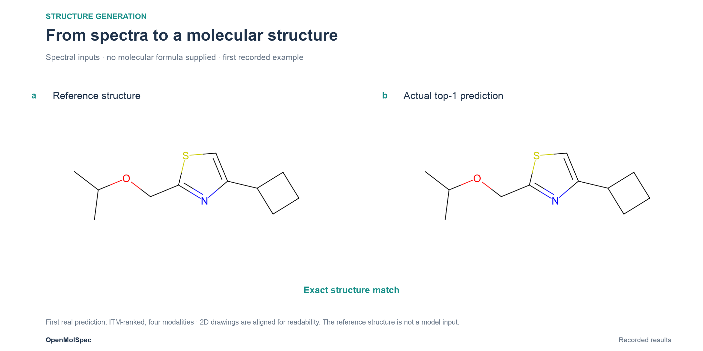

# IR + Raman + H/C → SMILES（Xinyu 协议）

使用 Xinyu 保存的 Vib2Mol 模型完成结构检索、SMILES 生成或候选重排。完整输入为 IR+Raman+H/C；仅 IR/Raman 的路径作为缺核消融。

## 示例与评测

已遵循作者生成协议，但同一 64 样本上 ITM 重排使 top-1 从 0.75 降到 0.6875；应先复查这项退化，再考虑重排器适配。

## 输入是什么

| Field | Meaning |
| --- | --- |
| `IR / Raman` | 每个可见通道 1024 个强度点，按 400→4000 cm⁻¹ 排列，并采用 checkpoint 的归一化。 |
| `1H / 13C` | 逐原子位移数组（ppm），参考 ID 和归一化必须与 checkpoint 一致。 |

## 输出是什么

| Field | Meaning |
| --- | --- |
| `SMILES candidates` | 解码后有效、规范化且去重的结构；完整输入路径使用 beam 10 和 ITM 重排。 |
| `top-k` | 分别报告生成与重排后的 top-k；不提供分子式。 |

## 真实运行案例

下面展示记录中的第一例，不按结果好坏筛选。长数组预览会标明完整长度；完整数值可下载证据 JSON。参考标签与模型输入分开保留。



[SVG](../assets/gallery/vibrational-generation-hc.svg) · [PNG](../assets/gallery/vibrational-generation-hc.png) · [Full input/output JSON](../assets/examples/vibrational-generation-hc.json)

<details><summary>展开查看实际输入与输出字段</summary>

```json
{
  "target": "CC(C)OCC1=NC(C2CCC2)=CS1",
  "raw_beams": {
    "length": 10,
    "first_values": [
      "CC(C)OCC1=NC(C2CCC2)=CS1",
      "CC(OCC1=NC(=CS1)C1CCC1)C",
      "CC(OCC1=NC(C2CCC2)=CS1)C",
      "CC(OCC1SC=C(N=1)C1CCC1)C"
    ]
  },
  "unique_candidates": [
    "CC(C)OCC1=NC(C2CCC2)=CS1"
  ],
  "reranked": [
    "CC(C)OCC1=NC(C2CCC2)=CS1"
  ],
  "positive_probabilities": [
    0.9998494386672974
  ],
  "input": {
    "ir": {
      "length": 1024,
      "first_values": [
        0.005309805274009705,
        0.005845691077411175,
        0.006656948011368513,
        0.007852676324546337
      ]
    },
    "raman": {
      "length": 1024,
      "first_values": [
        0.004348924849182367,
        0.0044013503938913345,
        0.0046332464553415775,
        0.005103452131152153
      ]
    },
    "nmr_h_shifts_ppm": {
      "length": 17,
      "first_values": [
        0.8246750235557556,
        0.8999750018119812,
        0.9729750156402588,
        1.1875749826431274
      ]
    },
    "nmr_c_shifts_ppm": {
      "length": 11,
      "first_values": [
        19.662874221801758,
        20.252174377441406,
        22.792875289916992,
        26.529874801635742
      ]
    },
    "nmr_reference_id": "tms-d6273f14fda3cb5e"
  }
}
```

</details>

## 实际评测结果

| Dataset / scope | Model / variant | Metric | Value |
| --- | --- | --- | ---: |
| recorded sample | recorded model | exact_canonical_top1 | 0.75 |
| recorded sample | recorded model | exact_canonical_top5 | 0.890625 |
| recorded sample | recorded model | valid_smiles_fraction | 0.959375 |
| recorded sample | recorded model | examples | 64 |
| recorded sample | ITM reranked | exact_canonical_top1 | 0.6875 |
| recorded sample | ITM reranked | exact_canonical_top5 | 0.890625 |

样本量和候选池随每次运行记录。图可能展示单个分子，表格是来源实验的实际汇总，不能混为同一统计范围。

## 模型与方法

复用原实现的 encode_spectra、canonical/unique_candidates 与 rerank_candidates。生成默认 beam=10、最大长度 300；先移除无效和重复规范结构，再对前 10 个候选用 ITM 正类概率重排。不提供分子式，也不使用近邻缓存回放。

检索报告双向 Recall@1/5/10、MRR 和候选池大小。生成同时报告原始 beam 的有效率、规范去重后的 top-1/3/5/10 及重排后的 top-k；重排始终使用明确的候选列表。

## 复现方式

[Notebook with executed figures](../notebooks/vibrational-generation-hc.ipynb) · [Quick Start](../quickstart.md)

```bash
python -m openmolspec_bench run --workspace /path/to/OpenMolSpec \
  --tasks vibrational.generation.hc --limit 8 --output results/vibrational-generation-hc-new.json
```

## 调用模型与微调

```python
from openmolspec.model import Vib2Mol
model = Vib2Mol(root='/path/to/portable-models',
    python='/path/to/vibrational-env/bin/python')
result = model.predict(inputs, allow_missing_modalities=False)
```

通过 [openSpec／Vib2Mol 作者训练流程](https://github.com/X1nyuLu/openSpec-alpha)进行适配。准备谱—结构对齐的 LMDB，保留 H/C 参考和归一化，确保 train/val 分组独立。检索采用双向对比交叉熵与配对分类交叉熵；生成使用分子 token 自回归交叉熵。性质回归按其训练配置保留目标变换和回归准则。SDK 提供推理，相关训练通过作者实现执行。

$$L_{\rm retrieval}=L_{\rm contrastive}+L_{\rm matching},\qquad L_{\rm generation}=-\sum_t\log p(y_t\mid y_{<t},s).$$

## 数据要求与引用

生成与重排 checkpoint 的 H/C 参考和归一化缓冲必须一致。小候选池可能让检索分数偏高，必须公布样本 ID、种子和来源组成。

<details><summary>来源报告与 SHA-256 指纹</summary>

- [vib2mol_xinyu_random64_20261116.json](https://github.com/jiaqingxie/openmolspec-studio-frontend/blob/release/openmolspec-v1/results/vib2mol_xinyu_random64_20261116.json) — SHA-256 `9f452a28aef3ff5af315cdbe1340c1844f7e3af139896490fba2d268fc970cc8`

</details>


[Original model / 原模型](https://github.com/X1nyuLu/openSpec-alpha) · [Model review / 模型检查](../model-audit.md)
