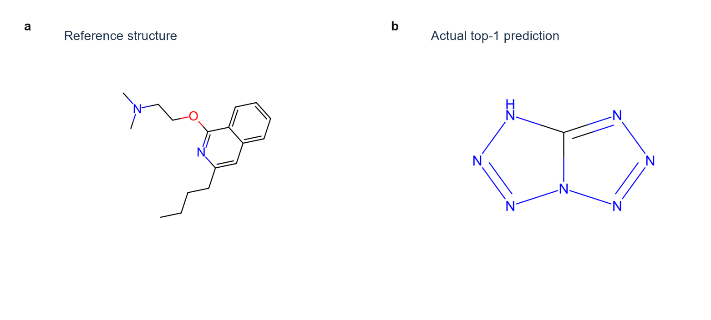

# Structure generation: IR + Raman

Generate structures from molecular spectra.

## What goes in

| Field | Meaning |
| --- | --- |
| `IR / Raman` | 1024 intensity samples per visible channel, ordered 400→4000 cm⁻¹, using the checkpoint normalization. |
| `missing channels` | The input mask selects visible channels from the shared four-modal checkpoint. |

## What comes out

| Field | Meaning |
| --- | --- |
| `SMILES candidates` | Decoded valid, canonical unique candidates; full-input route uses beam 10 and ITM reranking. |
| `top-k` | Generation and reranking scores are separate. No molecular formula is supplied. |

## A real recorded example

Inspect the input, prediction and reference for the example below. Download the JSON for the complete numerical arrays and additional examples.



[SVG](../assets/gallery/vibrational-generation.svg) · [PNG](../assets/gallery/vibrational-generation.png) · [Full input/output JSON](../assets/examples/vibrational-generation.json)

<details><summary>Inspect the actual input and output fields</summary>

```json
{
  "reference": "CCCCc1cc2ccccc2c(OCCN(C)C)n1",
  "raw_top_1": "N1=NN2N=NN=C2N1",
  "canonical_top_1": "n1nc2[nH]nnn2n1",
  "input": {
    "ir": {
      "length": 1024,
      "first_values": [
        0.012721044011414051,
        0.012162876315414906,
        0.011645566672086716,
        0.010846862569451332
      ]
    },
    "raman": {
      "length": 1024,
      "first_values": [
        0.026861174032092094,
        0.022829052060842514,
        0.02229130268096924,
        0.0217174980789423
      ]
    }
  }
}
```

</details>

## Actual evaluation results

| Dataset / scope | Model / variant | Metric | Value |
| --- | --- | --- | ---: |
| recorded sample | recorded model | valid_rate | 1 |
| recorded sample | recorded model | exact_rate | 0 |
| recorded sample | recorded model | examples | 4 |

## Model and method

The openSpec model encodes the spectral channels with Vib2Mol. Generation uses beam search and molecular matching scores; retrieval compares embeddings, and candidate reranking uses the matching head.

Report top-k accuracy for generation, and Recall@k/MRR for ranking.

## Reproduce

[Notebook with executed figures](../notebooks/vibrational-generation.ipynb) · [Quick Start](../quickstart.md)

```bash
python -m openmolspec_bench run --workspace /path/to/OpenMolSpec \
  --tasks vibrational.generation --limit 8 --output results/vibrational-generation-new.json
```

## Call and adapt this model

```python
from openmolspec.model import Vib2Mol
model = Vib2Mol(root='/path/to/portable-models',
    python='/path/to/vibrational-env/bin/python')
result = model.predict(inputs, allow_missing_modalities=True)
```

Use the [openSpec/Vib2Mol author training workflow](https://github.com/jiaqingxie/openmolspec-studio-frontend/tree/release/openmolspec-v1/documentation/assets/benchmarks) for adaptation. Export aligned spectral/structure LMDBs, retain H/C references and normalization, and keep train/validation groups disjoint. Retrieval combines symmetric contrastive cross-entropy with matching cross-entropy; generation adds autoregressive molecular-token cross-entropy. Property regression uses the target transform and regression criterion from its training configuration. SDK classes expose inference; these training workflows run in the author implementation.

$$L_{\rm retrieval}=L_{\rm contrastive}+L_{\rm matching},\qquad L_{\rm generation}=-\sum_t\log p(y_t\mid y_{<t},s).$$

<details><summary>Source reports and SHA-256 fingerprints</summary>

- [smoke_vib2mol_20261115.json](https://github.com/jiaqingxie/openmolspec-studio-frontend/blob/release/openmolspec-v1/results/smoke_vib2mol_20261115.json) — SHA-256 `2d847121c398071c68040623482a51118d1e20932779247b2eb72e071b8a8ae4`

</details>


[Model implementation / 模型实现](https://github.com/jiaqingxie/openmolspec-studio-frontend/tree/release/openmolspec-v1/documentation/assets/benchmarks) · [Model review / 模型检查](../model-audit.md)

## References

- OpenMolSpec contributors. openSpec models and benchmark training workflows. Source archive, v1.0 (2026). [Source](https://github.com/jiaqingxie/openmolspec-studio-frontend/tree/release/openmolspec-v1/documentation/assets/benchmarks)
- OpenMolSpec contributors. OpenMolSpec: Chemical spectroscopy datasets, models and learning workflows. Software release v1.0 (2026). [Source](https://github.com/jiaqingxie/openmolspec-studio-frontend/releases/tag/v1.0)
- Yuan, M., Zou, Z. & Hu, W. QMe14S, A Comprehensive and Efficient Spectral Dataset for Small Organic Molecules. arXiv:2501.18876 (2025). [Source](https://arxiv.org/abs/2501.18876)
- Zou, Z., Zhang, Y., Liang, L., Wei, M., Leng, J., Jiang, J., Luo, Y. & Hu, W. A deep learning model for predicting selected organic molecular spectra. Nature Computational Science 3, 957–964 (2023). doi:10.1038/s43588-023-00550-y. [Source](https://www.nature.com/articles/s43588-023-00550-y)
