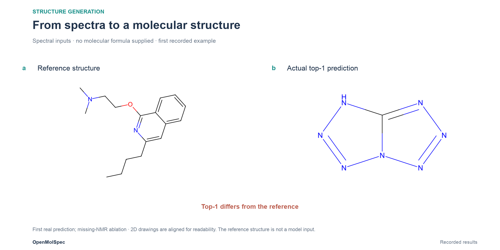

# 结构生成：IR + Raman

从分子谱图生成结构。

## 无分子式的结构生成

默认接口只需计算得到的 IR 和 Raman。位移估计模型在 11,632 个连通结构上拟合，预测氢、碳位移的数量和位置，再由冻结的解码器生成候选。在 24 个开发分子上，第一名命中 3/24；仅微调解码器输出层和直接留空 NMR 输入都为 0/24。另取 24 个独立分子，估计位移后第一名命中 2/24，前三名 5/24，前五名 6/24；留空 NMR 的原模型三项均为 0/24。结构匹配采用去除立体化学后的规范 SMILES。

```python
from openmolspec.model import Vib2Mol
model = Vib2Mol(root=openspec_root, python=model_python)
result = model.predict({"ir": ir, "raman": raman}, top_k=5)
candidates = result["candidates"]
estimated_ppm = result["estimated_shifts_ppm"]
```

下方示例图和原始评测表展示留空 NMR 的旧模型。当前 benchmark 已排除位移估计模型拟合及选参用到的全部 13,190 个连通结构。

## Xinyu Lu 发布的双谱模型

VB-Mols 的 MMM 解码器接受 IR、Raman 和独立提供的分子式。使用 10 条 beam，在作者 VB-Mols 测试集抽取的 24 个结构中，第一名命中 24 个；在 OpenMolSpec 抽取的另 24 个结构中命中 0 个。两组均按忽略立体化学的规范 SMILES 比较，覆盖的化学空间不同。下方原有案例使用无需分子式的 OpenMolSpec 解码器。[作者实现](https://github.com/X1nyuLu/vib2mol)

```python
from openmolspec.model import Vib2Mol

model = Vib2Mol(root=openspec_root, python=model_python)
result = model.predict_native(
    {"ir": ir, "raman": raman}, formula=formula, checkout=vib2mol_checkout
)
```

## 输入是什么

| Field | Meaning |
| --- | --- |
| `IR / Raman` | 每个可见通道 1024 个强度点，按 400→4000 cm⁻¹ 排列，并采用 checkpoint 的归一化。 |
| `estimated shifts` | 只给 IR 和 Raman 时，软件先估计氢、碳位移，再解码候选结构。调用原作者 VB-Mols 解码器时另需提供已知分子式。 |

## 输出是什么

| Field | Meaning |
| --- | --- |
| `SMILES candidates` | 从 10 条 beam 中取有效规范结构并按首次出现去重。SDK 默认保留该顺序，同时返回 ITM 排名。 |
| `top-k` | 分别报告生成与重排后的 top-k；不提供分子式。 |

## 真实运行案例

下面展示示例的输入、预测与参考。下载 JSON 可获取完整数值数组及更多示例。



[SVG](../assets/gallery/vibrational-generation.svg) · [PNG](../assets/gallery/vibrational-generation.png) · [Full input/output JSON](../assets/examples/vibrational-generation.json)

<details><summary>展开查看实际输入与输出字段</summary>

```json
{
  "reference": "CCCCc1cc2ccccc2c(OCCN(C)C)n1",
  "raw_top_1": "N1=NN2N=NN=C2N1",
  "canonical_top_1": "n1nc2[nH]nnn2n1",
  "input": {
    "ir": {
      "length": 1024,
      "first_values": [
        0.012721044011414051,
        0.012162876315414906,
        0.011645566672086716,
        0.010846862569451332
      ]
    },
    "raman": {
      "length": 1024,
      "first_values": [
        0.026861174032092094,
        0.022829052060842514,
        0.02229130268096924,
        0.0217174980789423
      ]
    }
  }
}
```

</details>

## 实际评测结果

| Dataset / scope | Model / variant | Metric | Value |
| --- | --- | --- | ---: |
| recorded sample | recorded model | valid_rate | 1 |
| recorded sample | recorded model | exact_rate | 0 |
| recorded sample | recorded model | examples | 4 |

## 模型与方法

openSpec 模型通过 Vib2Mol 编码谱通道。生成使用 beam search 和分子匹配分数；检索比较嵌入，候选重排使用匹配头。

生成报告 top-k 准确率，排序报告 Recall@k 与 MRR。

## 复现方式

[Notebook with executed figures](../notebooks/vibrational-generation.ipynb) · [Quick Start](../quickstart.md)

```bash
python -m openmolspec_bench run --workspace /path/to/OpenMolSpec \
  --tasks vibrational.generation --limit 8 --output results/vibrational-generation-new.json
```

## 调用模型与微调

```python
from openmolspec.model import Vib2Mol
model = Vib2Mol(root='/path/to/portable-models',
    python='/path/to/vibrational-env/bin/python')
result = model.predict(inputs)
```

通过 [openSpec／Vib2Mol 作者训练流程](https://github.com/jiaqingxie/openmolspec-studio-frontend/tree/release/openmolspec-v1/documentation/assets/benchmarks)进行适配。准备谱—结构对齐的 LMDB，保留 H/C 参考和归一化，确保 train/val 分组独立。检索采用双向对比交叉熵与配对分类交叉熵；生成使用分子 token 自回归交叉熵。性质回归按其训练配置保留目标变换和回归准则。SDK 提供推理，相关训练通过作者实现执行。

$$L_{\rm retrieval}=L_{\rm contrastive}+L_{\rm matching},\qquad L_{\rm generation}=-\sum_t\log p(y_t\mid y_{<t},s).$$

<details><summary>来源报告与 SHA-256 指纹</summary>

- [smoke_vib2mol_20261115.json](https://github.com/jiaqingxie/openmolspec-studio-frontend/blob/release/openmolspec-v1/results/smoke_vib2mol_20261115.json) — SHA-256 `2d847121c398071c68040623482a51118d1e20932779247b2eb72e071b8a8ae4`

</details>


[Model implementation / 模型实现](https://github.com/jiaqingxie/openmolspec-studio-frontend/tree/release/openmolspec-v1/documentation/assets/benchmarks) · [Model review / 模型检查](../model-audit.md)

## 参考文献

- OpenMolSpec contributors. openSpec models and benchmark training workflows. Source archive, v1.0 (2026). [Source](https://github.com/jiaqingxie/openmolspec-studio-frontend/tree/release/openmolspec-v1/documentation/assets/benchmarks)
- OpenMolSpec contributors. OpenMolSpec: Chemical spectroscopy datasets, models and learning workflows. Software release v1.0 (2026). [Source](https://github.com/jiaqingxie/openmolspec-studio-frontend/releases/tag/v1.0)
- Yuan, M., Zou, Z. & Hu, W. QMe14S, A Comprehensive and Efficient Spectral Dataset for Small Organic Molecules. arXiv:2501.18876 (2025). [Source](https://arxiv.org/abs/2501.18876)
- Zou, Z., Zhang, Y., Liang, L., Wei, M., Leng, J., Jiang, J., Luo, Y. & Hu, W. A deep learning model for predicting selected organic molecular spectra. Nature Computational Science 3, 957–964 (2023). doi:10.1038/s43588-023-00550-y. [Source](https://www.nature.com/articles/s43588-023-00550-y)
