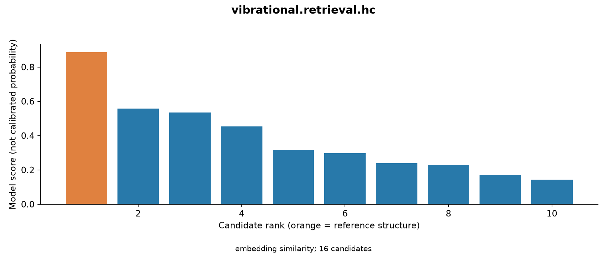

# Structure retrieval: IR + Raman + NMR

The [4,096-candidate comparison](../benchmarks/vibrational.md) reports embedding search, top-32 reranking and exhaustive matching, with separate query counts.

Rank molecular structures by agreement with the input spectra.

## Retrieval from 1,024 candidates

Using the OpenMolSpec four-channel checkpoint, with the reference present, embedding retrieval ranked it first for 63/64 queries. ITM rescoring of the top 16 gave 64/64. Exhaustive ITM scoring over all 1,024 candidates gave 8/8 on the prespecified first eight queries. Models shared identical queries and candidates. The pool contained same-formula distractors for 61 of the 64 queries.

## What goes in

| Field | Meaning |
| --- | --- |
| `IR / Raman` | 1024 intensity samples per visible channel, ordered 400→4000 cm⁻¹, using the checkpoint normalization. |
| `1H / 13C` | Per-atom shift arrays in ppm with the checkpoint-compatible reference ID and normalization. |
| `candidate structures` | The molecular candidate library to rank. |

## What comes out

| Field | Meaning |
| --- | --- |
| `ranking` | Candidate identities with similarity or ITM positive-class scores. |
| `recall / MRR` | Ranking metrics plus candidate-pool size and source composition. |

## A real recorded example

Inspect the input, prediction and reference for the example below. Download the JSON for the complete numerical arrays and additional examples.



[SVG](../assets/gallery/vibrational-retrieval-hc.svg) · [PNG](../assets/gallery/vibrational-retrieval-hc.png) · [Full input/output JSON](../assets/examples/vibrational-retrieval-hc.json)

<details><summary>Inspect the actual input and output fields</summary>

```json
{
  "sample_id": "ZINCV2-ZINC000646741030",
  "input": {
    "ir": {
      "length": 1024,
      "first_values": [
        0.15220004320144653,
        0.190755695104599,
        0.2037702202796936,
        0.1804114133119583
      ]
    },
    "raman": {
      "length": 1024,
      "first_values": [
        0.04284051060676575,
        0.0596662312746048,
        0.059223152697086334,
        0.04435715824365616
      ]
    },
    "nmr_h_shifts_ppm": {
      "length": 13,
      "first_values": [
        0.40027499198913574,
        0.70107501745224,
        3.4114749431610107,
        3.4215750694274902
      ]
    },
    "nmr_c_shifts_ppm": {
      "length": 13,
      "first_values": [
        17.115774154663086,
        31.026575088500977,
        43.290775299072266,
        55.238773345947266
      ]
    }
  },
  "reference_smiles": "O=C(c1n[nH]c2ccccc12)N1CCOC2CC21",
  "ranked_candidates": {
    "length": 10,
    "first_values": [
      {
        "smiles": "O=C(c1n[nH]c2ccccc12)N1CCOC2CC21",
        "score": 0.8860309720039368,
        "reference_match": true
      },
      {
        "smiles": "c1cnc2ncnc(NC3CCCC34CC4)c2c1",
        "score": 0.5585482716560364,
        "reference_match": false
      },
      {
        "smiles": "CC1CC(COC(=O)c2cnccc2Cl)C1",
        "score": 0.5353757739067078,
        "reference_match": false
      },
      {
        "smiles": "COc1ccncc1NC(=O)C1CC2(CCC2)C1",
        "score": 0.4536983370780945,
        "reference_match": false
      }
    ]
  }
}
```

</details>

## Actual evaluation results

| Dataset / scope | Model / variant | Metric | Value |
| --- | --- | --- | ---: |
| recorded sample | recorded model | recall_at_1 | 1 |
| recorded sample | recorded model | recall_at_5 | 1 |
| recorded sample | recorded model | recall_at_10 | 1 |
| recorded sample | recorded model | mrr | 1 |
| recorded sample | recorded model | queries | 16 |
| recorded sample | recorded model | candidate_pool | 16 |
| recorded sample | recorded model | unique_candidates | 16 |
| recorded sample | recorded model | tie_policy | stable_candidate_order |

## Model and method

The openSpec model encodes the spectral channels with Vib2Mol. Generation uses beam search and molecular matching scores; retrieval compares embeddings, and candidate reranking uses the matching head.

Report top-k accuracy for generation, and Recall@k/MRR for ranking.

## Reproduce

[Notebook with executed figures](../notebooks/vibrational-retrieval-hc.ipynb) · [Quick Start](../quickstart.md)

```bash
python -m openmolspec_bench run --workspace /path/to/OpenMolSpec \
  --tasks vibrational.retrieval.hc --limit 8 --output results/vibrational-retrieval-hc-new.json
```

## Call and adapt this model

```python
from openmolspec.model import Vib2Mol
model = Vib2Mol(root='/path/to/portable-models',
    python='/path/to/vibrational-env/bin/python')
result = model.retrieve(inputs, candidate_smiles,
    rerank=False, allow_missing_modalities=False)
```

Use the [openSpec/Vib2Mol author training workflow](https://github.com/jiaqingxie/openmolspec-studio-frontend/tree/release/openmolspec-v1/documentation/assets/benchmarks) for adaptation. Export aligned spectral/structure LMDBs, retain H/C references and normalization, and keep train/validation groups disjoint. Retrieval combines symmetric contrastive cross-entropy with matching cross-entropy; generation adds autoregressive molecular-token cross-entropy. Property regression uses the target transform and regression criterion from its training configuration. SDK classes expose inference; these training workflows run in the author implementation.

$$L_{\rm retrieval}=L_{\rm contrastive}+L_{\rm matching},\qquad L_{\rm generation}=-\sum_t\log p(y_t\mid y_{<t},s).$$

<details><summary>Source reports and SHA-256 fingerprints</summary>

- [vibrational_ranked_examples_20261117.json](https://github.com/jiaqingxie/openmolspec-studio-frontend/blob/release/openmolspec-v1/results/vibrational_ranked_examples_20261117.json) — SHA-256 `b7e464aa11e85fdcae7245d987d92f272d6c1a5e47d697734df17d26731744e3`

</details>


[Model implementation / 模型实现](https://github.com/jiaqingxie/openmolspec-studio-frontend/tree/release/openmolspec-v1/documentation/assets/benchmarks) · [Model review / 模型检查](../model-audit.md)

## References

- OpenMolSpec contributors. openSpec models and benchmark training workflows. Source archive, v1.0 (2026). [Source](https://github.com/jiaqingxie/openmolspec-studio-frontend/tree/release/openmolspec-v1/documentation/assets/benchmarks)
- OpenMolSpec contributors. OpenMolSpec: Chemical spectroscopy datasets, models and learning workflows. Software release v1.0 (2026). [Source](https://github.com/jiaqingxie/openmolspec-studio-frontend/releases/tag/v1.0)
- Yuan, M., Zou, Z. & Hu, W. QMe14S, A Comprehensive and Efficient Spectral Dataset for Small Organic Molecules. arXiv:2501.18876 (2025). [Source](https://arxiv.org/abs/2501.18876)
- Zou, Z., Zhang, Y., Liang, L., Wei, M., Leng, J., Jiang, J., Luo, Y. & Hu, W. A deep learning model for predicting selected organic molecular spectra. Nature Computational Science 3, 957–964 (2023). doi:10.1038/s43588-023-00550-y. [Source](https://www.nature.com/articles/s43588-023-00550-y)
